# Cosiness

Creators:
Александр Резчиков
Дубиков Егор
Дикусарэ Сергей

# Основная информация

# Cosiness ☕

Сайт кофейни «Уют» — уютное место, где время течёт медленнее.
Проект создан как демонстрационный многостраничный сайт с корзиной,
профилем пользователя и оформлением заказов.

---

## 📖 О проекте

**Cosiness** — это веб-сайт кофейни, где можно:

- посмотреть меню и добавить блюда в корзину;
- оформить заказ (сохраняется в истории заказов);
- вести личный профиль с данными пользователя;
- узнать о философии заведения;
- посмотреть фотографии интерьера и команды;
- связаться с администрацией через форму обратной связи.

Сайт не требует серверной части — вся логика работает на стороне клиента
с использованием `localStorage`. Это позволяет сохранять состояние корзины,
данные профиля и историю заказов между визитами.

---

# 🎯 Основные возможности

## Пользовательская часть

- **Главная** — приветственный баннер, преимущества, популярные позиции.
- **Меню** — позиции разбиты по категориям с раскрывающимися списками.
  У каждой позиции есть счётчик для добавления в корзину.
- **О нас** — история и подход к приготовлению кофе.
- **Галерея** — фотографии интерьера, блюд и команды.
- **Контакты** — форма обратной связи с уведомлением об отправке.
- **Корзина** — просмотр добавленных позиций, изменение количества,
  подсчёт стоимости со скидкой постоянного гостя, оформление заказа.
- **Профиль** — редактирование личных данных, история заказов.

## Технические особенности

- Единый бейдж корзины в шапке сайта — количество позиций видно на любой странице.
- Данные хранятся в `localStorage` под ключами `cosiness_*`.
- Плавные анимации появления элементов при прокрутке.
- Адаптивная вёрстка для мобильных устройств.
- Единый стиль через CSS-переменные (`--primary`, `--dark`, `--light`).

---

## 🗂 Структура проекта

cosiness/
├── index.html # Главная
├── menu.html # Меню
├── about.html # О нас
├── gallery.html # Галерея
├── contacts.html # Контакты
├── cart.html # Корзина
├── profile.html # Профиль
│
├── css/
│ └── style.css # Все стили проекта
│
├── js/
│ ├── cart.js # Общая логика корзины (для всех страниц)
│ ├── menu.js # Аккордеон и счётчики меню
│ ├── gallery.js # Анимация галереи
│ ├── contacts.js # Обработка формы обратной связи
│ ├── cart-page.js # Отрисовка корзины и оформление заказа
│ └── profile.js # Профиль и история заказов
│
└── images/
├── coffee_bean.png # Логотип
├── banner.jpg # Фон hero-секции
├── interier.jpg # Галерея
├── coffe.jpg # Галерея
├── desert.jpg # Галерея
└── motherbossbird.png

# Запуск

## 🚀 Запуск проекта

1. Скачать или склонировать папку проекта.
2. Открыть `index.html` в браузере.

Сайт работает без сборки и без сервера — это чистый HTML/CSS/JS.
Однако для корректной работы `localStorage` рекомендуется запускать
через локальный сервер (например, `Live Server` в VS Code) либо просто
открывать через `file://` — оба варианта допустимы.

---

# 🧠 Как это устроено

## Хранение данных

Всё состояние хранится в `localStorage` браузера:

| Ключ                | Что хранит                              |
|---------------------|-----------------------------------------|
| `cosiness_cart`     | Содержимое корзины (id, название, цена, количество) |
| `cosiness_orders`   | История оформленных заказов             |
| `cosiness_profile`  | Данные профиля пользователя             |

> Данные не отправляются на сервер и остаются только в браузере.
> При очистке хранилища они удаляются.

## Архитектура JS

- `cart.js` — **общий модуль**, подключается на страницах, где нужен
  бейдж корзины (меню, корзина, профиль). Содержит `getCart`,
  `saveCart`, `updateCartBadge`.
- Остальные файлы — **специфичны для своей страницы** и подключаются
  только там, где нужны.

Порядок подключения на страницах с корзиной:

```html
<script src="js/cart.js"></script>
<script src="js/menu.js"></script>  <!-- или cart-page.js, profile.js -->

# Диаграмма

```mermaid
graph TD
    Root["Cosiness /"]

    Root --> CSS["css/"]
    Root --> Images["images/"]
    Root --> JS["js/"]

    CSS --> Style["style.css (15.4 KB)"]

    JS --> MainJS["main.js (274 B)"]
    JS --> CartJS["cart.js (1004 B)"]
    JS --> CartPageJS["cart-page.js (4868 B)"]
    JS --> ContactsJS["contacts.js (553 B)"]
    JS --> GalleryJS["gallery.js (335 B)"]
    JS --> MenuJS["menu.js (2712 B)"]
    JS --> ProfileJS["profile.js (3561 B)"]

    Root --> Index["index.html (4180 B)"]
    Root --> About["about.html (1919 B)"]
    Root --> Cart["cart.html (1759 B)"]
    Root --> Contacts["contacts.html (1950 B)"]
    Root --> Gallery["gallery.html (2247 B)"]
    Root --> Menu["menu.html (20619 B)"]
    Root --> Profile["profile.html (3119 B)"]
    Root --> Readme["README.md (144 B)"]

    classDef folder fill:#4A90D9,color:#fff,stroke:#2C5F8A
    classDef html fill:#E67E22,color:#fff,stroke:#B35F14
    classDef js fill:#F1C40F,color:#333,stroke:#B7950B
    classDef css fill:#2ECC71,color:#fff,stroke:#1E8A4E
    classDef other fill:#95A5A6,color:#fff,stroke:#6B7879

    class Root,CSS,Images,JS folder
    class Index,About,Cart,Contacts,Gallery,Menu,Profile html
    class MainJS,CartJS,CartPageJS,ContactsJS,GalleryJS,MenuJS,ProfileJS js
    class Style css
    class Readme other
```

